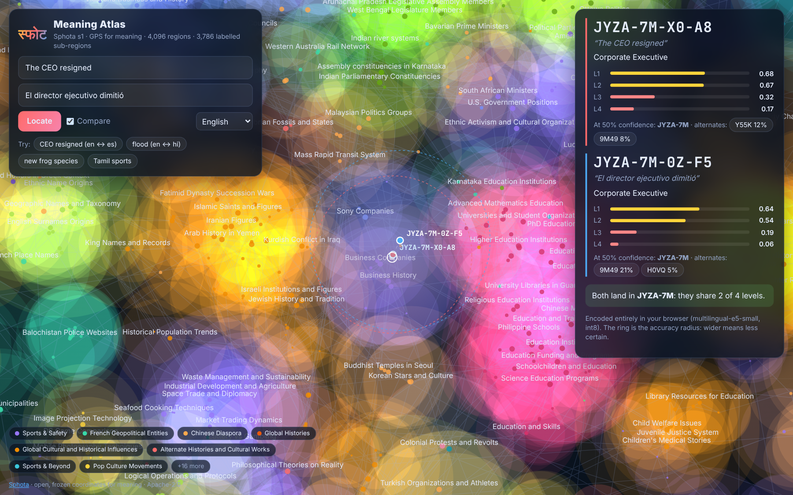

<div align="center">

# स्फोट Sphota

### GPS for meaning.

An open, **frozen**, human-readable coordinate system for meaning.
Any text, in any language, embedded by any supported model → one short hierarchical code.

[](https://github.com/thiruvikramanpravartak/sphota/actions/workflows/ci.yml)
[](LICENSE)

-brightgreen)




*The [Meaning Atlas](atlas/): type a sentence in any language, it is encoded in your browser and lands on its coordinate.*

</div>

```text
"The CEO resigned"               (en)  →  JYZA-7M-X0-A8
"El director ejecutivo dimitió"  (es)  →  JYZA-7M-0Q-BS     same region, same sub-region
"CEOが辞任した"                   (ja)  →  JYZA-7M-X0-A8     identical code
 └──┬─┘ └┬┘ └┬┘ └┬┘
   L1   L2  L3  L4      broad topic → sub-topic → theme → near-paraphrase
```

## The idea

In Bhartṛhari's philosophy of language (*Vākyapadīya*, 5th c.), **sphoṭa** is the meaning that
"bursts forth" as a whole: the same however it is uttered. Sounds, words and languages are
only vehicles.

Today's vehicles are embedding models, and every one of them speaks a private dialect: a vector
from model A means nothing to model B, cannot be read, and must be recomputed for your whole
corpus whenever you upgrade. Sphota gives meaning a **shared address**: a frozen 256-d
canonical space plus a 4-level codebook, published once and never changed, with small
adapters that bring other models into it.

## Quick start (60 seconds, CPU, no config)

```bash
pip install "sphota[encode,cli]"
```

```python
>>> from sphota import encode
>>> c = encode("The CEO resigned")
>>> c
Sphota('JYZA-7M-X0-A8')
>>> c.label
'Corporate Executive'
>>> c.confidence                       # GPS-style accuracy: how sure each prefix is
[0.8, 0.78, 0.42, 0.14]
>>> encode("The CEO resigned", min_confidence=0.6)
Sphota('JYZA-7M')                      # keep only what we're sure about
```

The encoder (multilingual-e5-small, ONNX) downloads once and is cached; then everything runs
offline. Codes are plain strings: put them in SQL, URLs, logs, spreadsheets.

```bash
sphota encode "सीईओ ने इस्तीफा दे दिया" --alternates     # any language
sphota analyze tickets.csv -o report.html               # topics of a whole file
sphota certify --model sentence-transformers/all-MiniLM-L6-v2
```

## What you can do with it

| Use case | One line | Notes |
|---|---|---|
| **Never re-index again** | `CodeIndex().add_texts(docs, model="A")` … `.search(q, model="B")` | items store code + canonical vector; switching models changes only queries ([benchmark](docs/benchmark.md#6-never-re-index-cross-model-retrieval)) |
| Topic analytics | `sphota analyze data.csv` | standalone HTML report: prefix tree, counts, samples, labels in 11 languages |
| Cross-lingual search & dedupe | `cross_lingual_search(q, docs)`, `dedupe(texts)` | Tamil query → Hindi, Spanish, English docs |
| Semantic cache | `SemanticCache(depth=2).get_or_compute(q, llm)` | hits across paraphrases and languages |
| Routing | `PrefixRouter().fit(examples, routes).route(text)` | rules written once apply to every language |
| Document fingerprints | `compare(a, b)`, `diff(a, b).added` | "which topics were added in v2?" |
| SQL / vector DBs | `WHERE code LIKE 'JYZA-7M%'` | Postgres helpers, LangChain, LlamaIndex, Qdrant ([integrations](integrations/)) |
| Share codes, not text | `encode(t, max_level=1)` | privacy by depth; codes still reveal topics ([privacy](docs/privacy.md)) |

## What makes it different

* **Precision levels like GPS accuracy.** Calibrated per-level confidence; `min_confidence`
  returns a shorter, correct code instead of a long, wrong one.
* **Boundary-aware.** `c.alternates` and `c.candidates(k)` give the other likely codes with
  probabilities; an optional stable mode; hierarchy-aware `similarity`, `neighbors`, `path`.
* **Multilingual by construction.** Languages are aligned *before* quantizing
  (meaning-LDA on parallel data): +35% relative L1 agreement over plain PCA.
* **Human-readable.** Crockford base32, fixed widths, typo detection (85% of single-symbol
  typos rejected without a checksum), labels in 11 languages (machine-generated; Hindi/Tamil/Bengali quality is mixed).
* **A standard, not a model.** RFC-style [spec](docs/spec/), golden tests that pin every code,
  `sphota certify` conformance certificates, adapter registry, migration tooling for `s2`.
* **Light.** Parse/compare/distance/labels need only numpy; encoding uses ONNX Runtime (no
  torch); runs in the browser; `sphota bundle` for air-gapped machines.

## Measured (honest) results

`small`-scale build on CPU, test data never used for fitting (FLORES-200 devtest, 12
languages; STS-B paraphrases). Full tables: [docs/benchmark.md](docs/benchmark.md).

| Measure | L1 | L2 | L3 | L4 |
|---|---|---|---|---|
| Translation gets the same prefix (en ↔ 11 languages) | **46%** | 23% | 11% | 5% |
| Paraphrase gets the same prefix (English) | **72%** | 54% | 38% | 28% |
| …with `min_confidence=0.7`, codes never contradict (shorter is a prefix of longer) | see [table](docs/benchmark.md#3-precision-truncation-gps-accuracy) | | | |

| Never re-index (index with model X, query with the anchor) | recall@10 |
|---|---|
| re-embed everything with one model (baseline) | 100% |
| **Sphota canonical vectors**, all-MiniLM-L6 / bge-small / gte-small / multilingual-MiniLM | **96.5% / 99.1% / 99.0% / 98.5%** |
| Sphota codes only (13 characters, no vectors) | 10–28% (coarse: for grouping/routing, not ranking) |

Utilization: 92% of the 4096 L1 cells used, largest cell 0.3% of data (no codebook collapse).
Speed: 160 sentences/s (fp32 ONNX, 4 vCPU), 310/s int8; 10k vectors/s quantization.

**Limitations.** Discretization cuts some equivalent texts apart: agreement is probabilistic and
falls with depth; very short sentences in some languages get low confidence. Exact code identity
*across models* is modest (6–23% at L1); certification guarantees neighbourhood-level
interoperability (spec Part 8). This repository ships a `small`-scale build (≈78k sentences,
12 languages); a GPU `full`-scale build is the next step. Labels are machine-generated.

## How it works

```text
text ─▶ anchor model (multilingual-e5-small, 384-d) ─▶ y = (x − μ)·W   (frozen meaning-LDA, 256-d)
other model ─▶ certified linear adapter ─────────────┘
y ─▶ residual k-means 4096 · 256 · 256 · 256 ─▶ (i1,i2,i3,i4) + calibrated confidence
  ─▶ affine permutation + Crockford base32 ─▶ JYZA-7M-X0-A8
```

Design decisions and the experiments behind them (including negative results) are in
[DECISIONS.md](DECISIONS.md); prior art and positioning in
[docs/research/gap-analysis.md](docs/research/gap-analysis.md); the paper draft in
[docs/paper/](docs/paper/sphota.md).

## Compared with alternatives

| | Sphota | Raw embeddings | Semantic IDs (RQ-VAE, recsys) | Embedding adapters (pairwise) | vec2vec | SONAR / LCM | Topic models |
|---|---|---|---|---|---|---|---|
| Open, frozen, versioned standard | **yes** | – | – (private per system) | – | – | – | – (refit per corpus) |
| Human-readable hierarchical codes | **yes** | – | integer tuples | – | – | – | per-run IDs |
| Many models → one space | **hub adapters** | – | – | N² pairwise | pairwise, unpaired | one family | – |
| Multilingual by design | **aligned before quantizing** | model-dependent | – | – | – | yes | – |
| Calibrated confidence / truncation | **yes** | – | – | – | – | – | – |
| Conformance certificates | **yes** | – | – | – | – | – | – |
| Fine-grained ranking | via canonical vectors | **yes** | – | yes | yes | yes | – |

## Project map

| | |
|---|---|
| [`src/sphota/`](src/sphota/) | library (core is numpy-only), CLI, use cases, integrations |
| [`src/sphota/data/v1/`](src/sphota/data/v1/) | the frozen s1 release (checksummed manifest) |
| [`docs/spec/`](docs/spec/) | specification (RFC style) |
| [`atlas/`](atlas/) | Meaning Atlas (Vite + TypeScript + transformers.js) |
| [`examples/`](examples/) | runnable examples (run in CI) |
| [`bench/`](bench/) | results JSON + static [leaderboard](bench/leaderboard/index.html) |
| [`integrations/`](integrations/) | Postgres SQL, docker-compose, integration docs |
| [`launch/`](launch/) | launch kit |

## Roadmap

1. **`full`-scale build on a GPU** (millions of sentences, 100+ languages) as space `s2`, with an
   `s1 → s2` migration table.
2. Larger anchor candidates (bge-m3 / LaBSE class) evaluated for `s2`; more certified adapters.
3. Better label quality (human review drive for Hindi, Tamil and other languages).
4. Native SQL similarity (pgvector bridge) and more vector-DB integrations.

## Citing

```bibtex
@misc{sphota2026,
  title  = {Sphota: An Open, Frozen, Human-Readable Coordinate System for Meaning},
  author = {{The Sphota Authors}},
  year   = {2026},
  note   = {https://github.com/thiruvikramanpravartak/sphota}
}
```

Code: Apache-2.0. Release artifacts derive from CC-BY-SA data (FLORES-200, Wikipedia) and MIT /
Apache-2.0 models; see [NOTICE](NOTICE) and [third-party licenses](docs/LICENSES-THIRD-PARTY.md).
