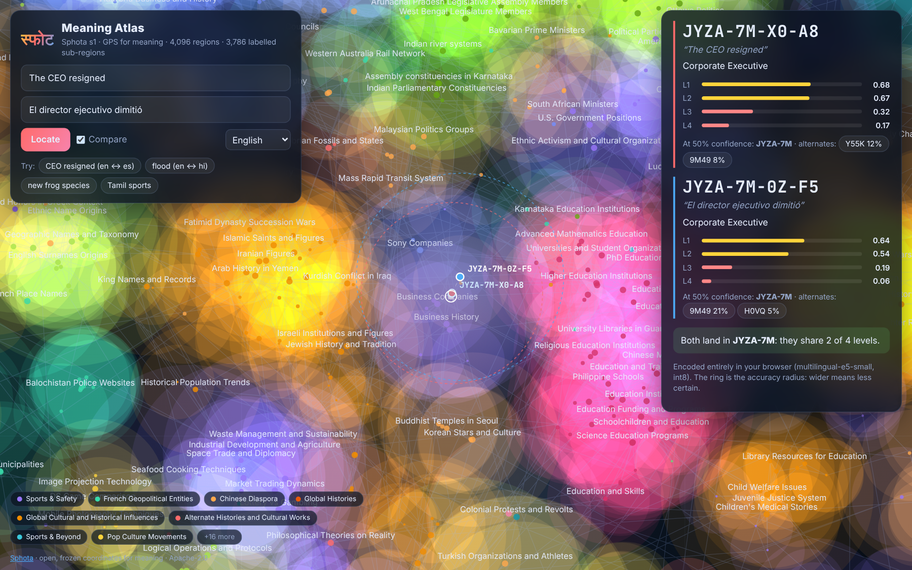

# Sphota

**Readable, multilingual meaning codes for topic analytics, routing, caching and model migration.**
Every text gets a frozen hierarchical code and one of 32 regions that is stable across languages
(79% for confident codes) and models (64.5%); stored canonical vectors give 96.5–99.1% recall
when you switch embedding models. Finer levels are precision within a model.

```text
"The CEO resigned"               (en)  →  JYZA-7M-X0-A8
"El director ejecutivo dimitió"  (es)  →  JYZA-7M-0Q-BS
"CEOが辞任した"                   (ja)  →  JYZA-7M-X0-A8
```



* **[Quick start](quickstart.md)**: `pip install sphota`, one line of Python, 60 seconds.
* **[Concepts](concepts.md)**: levels, confidence (GPS accuracy), alternates, labels.
* **[Use cases](usecases.md)**: never re-index, topic analytics, cross-lingual search, caching, routing.
* **[Benchmarks](benchmark.md)**: every number, measured on held-out data, with limitations.
* **[Specification](spec/README.md)**: the standard, written like an RFC.
* **[Privacy](privacy.md)**: codes reveal topics; share only the depth you need.

The name comes from Bhartṛhari's *sphoṭa* (स्फोट): the meaning that "bursts forth" whole and
stays the same however it is expressed.
